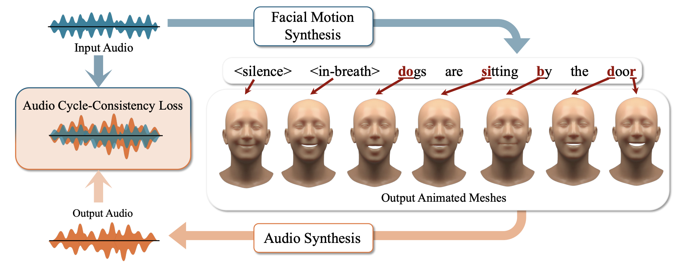

<h1 align="center">⚡⚡⚡ THUNDER: Supervising 3D Talking Head Avatars with Analysis-by-Audio-Synthesis ⚡⚡⚡</h1>

  

    <a href="https://radekd91.github.io/"><strong>Radek Daněček</strong></a>    
    .
    <a href="https://ps.is.tuebingen.mpg.de/person/cschmitt"><strong>Carolin Schmitt</strong></a>    
    .
    <a href="https://ps.is.tuebingen.mpg.de/person/senya"><strong>SEnya Polikovsky</strong></a>
    .
    <a href="https://ps.is.tuebingen.mpg.de/person/black"><strong>Michael J. Black</strong></a>
  

  

 

   
    
    
    
    

Welcome to the repository for THUNDER: Supervising 3D Talking Head Avatars with Analysis-by-Audio-Synthesis.

### Overview

The initial release covers inference and demos for the V1 / unversioned THUNDER models, TFHP / 3DV models, and their mesh-to-speech support models. Training workflows are planned for a later release.

- [TalkingHead](apps/TalkingHeadV2/README.md): speech-driven 3D talking-head generation. See the [model zoo](apps/TalkingHeadV2/MODEL_ZOO.md) for model and asset dependencies.
- [Mesh2Speech](apps/Mesh2Speech/README.md): speech generation from reconstructed facial motion, with mesh-to-speech and silent-video-to-speech model bundles listed in its [model zoo](apps/Mesh2Speech/MODEL_ZOO.md).

The main model implementations are [DiffusionTalkingHead.py](models/DiffusionTalkingHead.py), [MotionLatentDiffusion.py](models/MotionLatentDiffusion.py), and [MeshToSpeech.py](models/MeshToSpeech.py).

### Setup

THUNDER uses [INFERNO](https://github.com/radekd91/inferno) through `inferno.sandbox.thunder`. This release provides command-line inference demos and shared model code; training workflows and notebooks are deferred.

Follow the [Docker inference setup](docker/inference/README.md) to clone the repositories, load the prebuilt image or build the environment locally, and run demos. Inferno, THUNDER, model weights, assets and example data stay on the host and are mounted into the container. Editing project code does not require rebuilding the image.

The environment uses Python 3.9, PyTorch 2.1.1, PyTorch3D 0.7.9 and Transformers 4.36.2. Download the [prebuilt Docker image](https://download.is.tue.mpg.de/thunder/docker_images/thunder_docker.tar) (approximately 7.95 GB), or build it locally using the supplied script. See [download, checksum and loading instructions](docker/inference/README.md#use-the-prebuilt-image). Loading the image replaces the build step; repository preparation and model/asset downloads are still required.

Follow the app READMEs for demo commands and the model zoos for asset paths. Set `INFERNO_ROOT` explicitly when using download helpers. Model bundles and external repositories are separate from this Git repository.

# Acknowledgements

This project was built while borrowing code from some of the following:

- [lip2speech-unit](https://github.com/choijeongsoo/lip2speech-unit/tree/main) 
- [motion-latent-diffusion](https://github.com/ChenFengYe/motion-latent-diffusion) 
- [Real-Time-Voice-Cloining](https://github.com/CorentinJ/Real-Time-Voice-Cloning?tab=License-1-ov-file#readme)
- [inferno](https://github.com/radekd91/inferno)

We thank the authors for open-sourcing their SW.

# License

Most of the code is licensed under the license in the main license file. 

However, parts of the repo were borrowed from other repositories. Some of these have a non-commercial license. [lip2speech-unit](https://github.com/choijeongsoo/lip2speech-unit/tree/main). Code in [mesh2speech externals](models/mesh2speech/external), 
which are inheriting from a non-commerical open-source license, most importantly the Vocoders (for transorming mel and code sequences into final audio, come from non-commercial [speech-resynthesis](https://github.com/facebookresearch/speech-resynthesis) ) 
